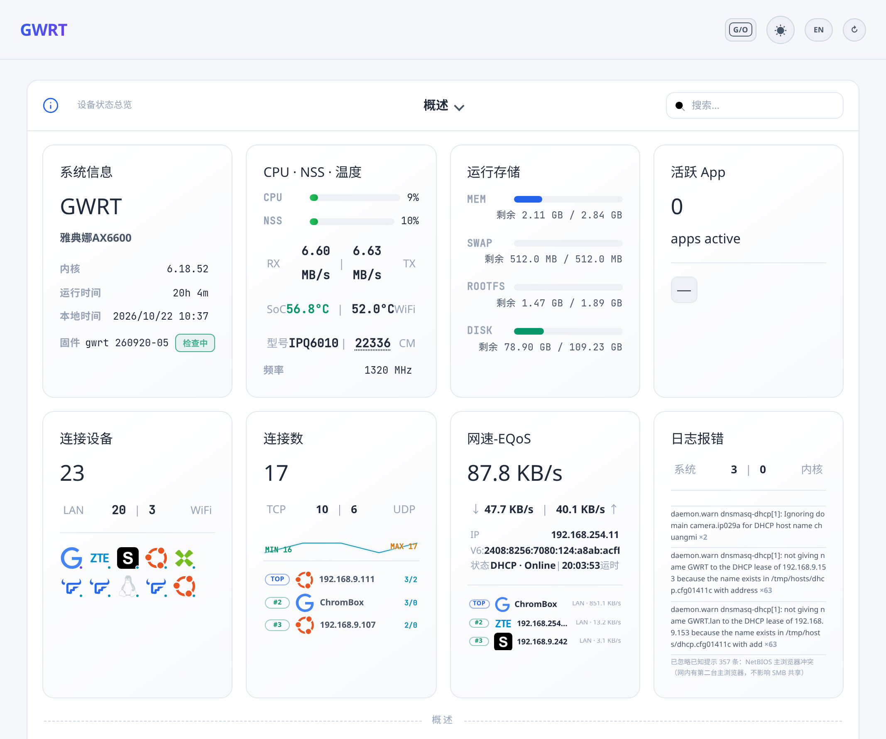
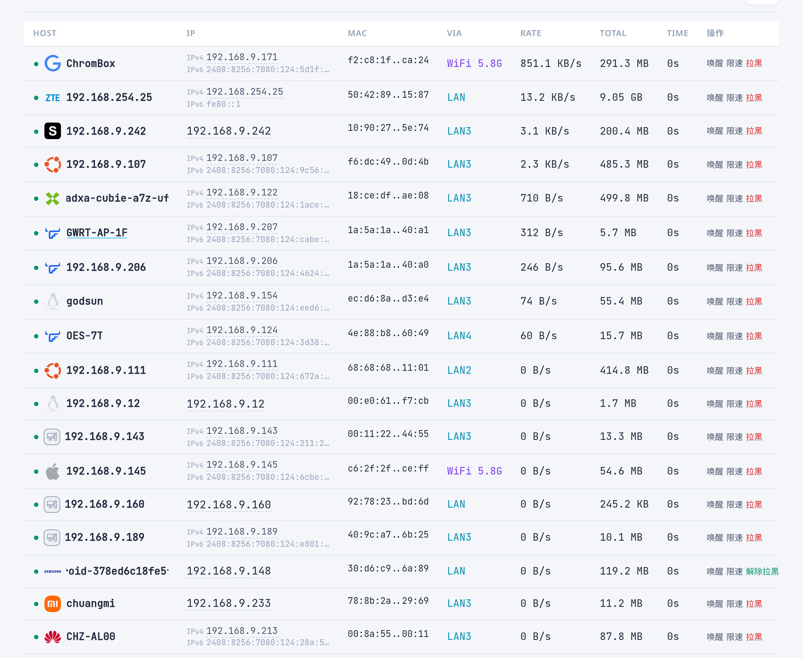
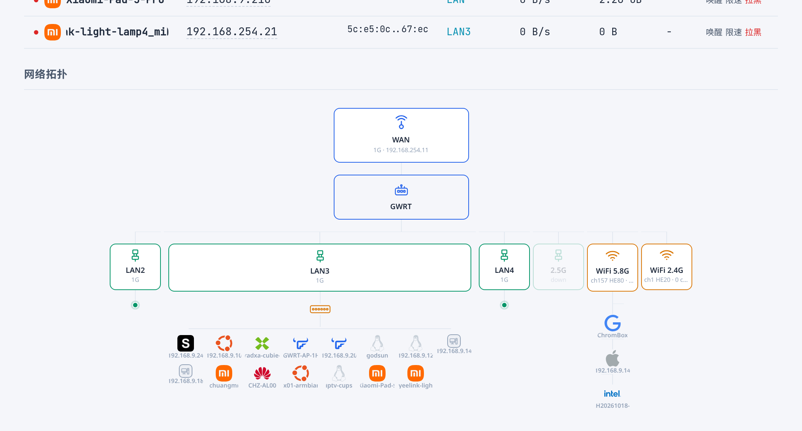

# GWRT Theme (luci-theme-gwrt)

[](LICENSE)
[](https://openwrt.org)
[](VERSION)

一个为 **ImmortalWrt / OpenWrt (LuCI, ucode 模板)** 设计的现代 LuCI 主题，内置信息密集型仪表盘、应用图标识别、设备品牌指纹、EQoS 限速面板。

## 📸 预览

**仪表盘首页** — 系统信息 / CPU·NSS·温度 / 运行存储 / 活跃 App / 连接设备 / 连接数 / 网速-EQoS / 日志报错



**接入设备列表** — 品牌图标自动识别（OUI + DHCP 指纹）、限速/拉黑/唤醒



**网络拓扑** — WAN / LAN / 2.5G / WiFi 与挂载设备的可视化



## ✨ 特性

- **现代深/浅色双主题**：登录页与全站界面均支持一键切换，样式基于 CSS 变量（`cascade.css`）
- **仪表盘首页**（`admin_status/index_gwrt.ut`）：系统信息、CPU/温度、内存存储、活跃 App、连接设备、连接数、网口状态图、NTP 同步、CoreMark 跑分等聚合展示
- **应用图标识别**：内置 226 张 App 图标 + emoji 回退链（PNG → emoji → 分类 emoji → 📦）；若系统装有应用过滤（appfilter）插件，可进一步按 App 展示流量
- **设备品牌识别**：
  - `oui-vendors.json`：41 个品牌 / 8637 条 OUI 前缀
  - `clients.sh` 常驻守护 + `gwrt-dhcp-fp`（dnsmasq dhcp-script，option 60/55/61）采集设备指纹
- **EQoS 智能限速**：首页直接管理总上行/下行与单设备限速
- **状态菜单图标化**：路由、防火墙、日志、进程、信道分析、实时图表等以图标形式并入概览网格
- **中英双语菜单 i18n**（`menu-i18n.js`）
- **网络拓扑可视化**：WAN/LAN/2.5G/WiFi 与接入设备的图形化布局
- **DHCP 租约默认展开**、双端口双主题（80/443 端口可映射不同主题）等细节优化

> **本仓库不含 OTA 功能**：固件在线升级（manifest 拉取 / 完整固件升级按钮）已移除，
> 升级请走各固件自身的 OTA 通道。
>
> **本仓库不集成任何第三方应用特征数据库**：不含 OpenAppFilter 的 `feature.bin`，
> 也不含被改写并强制覆盖的第三方 LuCI 视图。应用过滤相关能力全部通过
> 标准 ubus 接口**可选探测**——系统自行安装 `appfilter` 插件时主题才会显示
> 对应数据，未安装则自动降级。

## 🤖 让 Agent 一键接入

**直接把 [`docs/AGENT-PROMPT.md`](docs/AGENT-PROMPT.md) 里的提示词粘给你的 Agent 即可**，
它会自动探测环境并选择集成路径（编译进固件 / 装到运行中的路由器 / 离线装包）。

<details>
<summary>展开提示词全文</summary>

````text
请帮我把 GWRT LuCI 主题接入我的 OpenWrt / ImmortalWrt 设备。

【仓库】https://github.com/rothdren-lion/gwrt-theme
【主题版本】1.0-r111（Apache-2.0，开源版：已去除 OTA 与第三方应用特征库）

━━━ 第一步：判断接入方式 ━━━

先探测我的环境，再选路径：

A) 我有固件源码树（有 package/ 和 feeds/ 目录，.config 存在）
   → 走【方案 A：集成进固件编译】

B) 我只有一台运行中的路由器（能 SSH / LuCI 访问）
   → 走【方案 B：直接装到路由器】

C) 我只有主题包文件（.ipk / .apk），没有源码树
   → 走【方案 C：离线装包】

先执行探测，不要问我，直接用探测结果决定。

━━━ 方案 A：集成进固件编译 ━━━

1. git clone https://github.com/rothdren-lion/gwrt-theme.git gwrt-theme
2. ./gwrt-theme/scripts/integrate.sh --tree .
   验证：./gwrt-theme/scripts/integrate.sh --tree . --check
3. make package/luci-theme-gwrt/clean
   make package/luci-theme-gwrt/compile -j$(nproc)
4. 整机固件：./gwrt-theme/scripts/build-with-theme.sh --tree . -j6
5. 验证：ls -la bin/packages/*/base/luci-theme-gwrt-*.apk

━━━ 方案 B：直接装到运行中的路由器 ━━━

1. ssh root@<ip> 'command -v apk || command -v opkg'
2. scp luci-theme-gwrt-*.apk root@<ip>:/tmp/
   ssh root@<ip> 'apk add --allow-untrusted /tmp/luci-theme-gwrt-*.apk'
3. 配套插件：
   ssh root@<ip> 'wget -O- https://raw.githubusercontent.com/rothdren-lion/gwrt-theme/main/release/install-plugins.sh | sh'
4. ssh root@<ip> 'rm -f /tmp/luci-indexcache.*; rm -rf /tmp/luci-modulecache/; /etc/init.d/rpcd reload; /etc/init.d/gwrt-clients restart 2>/dev/null; /etc/init.d/dnsmasq reload 2>/dev/null'
5. ssh root@<ip> "uci set luci.main.mediaurlbase='/luci-static/gwrt'; uci set luci.themes.Gwrt='/luci-static/gwrt'; uci commit luci"
6. 打开 http://<router-ip>/cgi-bin/luci/admin/status/overview 验证

━━━ 方案 C：离线装包 ━━━

1. scp *.apk root@<ip>:/tmp/ && ssh root@<ip> 'apk add --allow-untrusted /tmp/*.apk'
2. 若 uci-defaults 已被执行过（脚本被删），手动补跑：
   sh 33_gwrt-dashboard   # 替换 admin_status 入口模板
   sh 36_gwrt-clients-init # 启用设备守护
   sh 37_gwrt-dhcp-fp     # 启用 DHCP 指纹钩子
3. 配套插件从你自己的固件源装（仓库不分发第三方二进制包）：
   流量统计 bandix-plus+luci-app-bandix-plus / 跑分 coremark / 终端 ttyd+luci-app-ttyd
   应用过滤 appfilter+luci-app-oaf+kmod-oaf（内核模块必须按机型获取，不可跨架构）
   助手脚本：wget -O- .../release/install-plugins.sh | sh

━━━ 通用注意事项 ━━━

- 本仓库已去除 OTA 功能。
- 主题不强制依赖配套插件：缺应用过滤插件则「活跃 App」为空，缺 bandix-plus 则网速卡片回退。
- 装完必须清 LuCI 缓存 + reload rpcd。
- 开发时只改 theme/luci-theme-gwrt/，改完跑 integrate.sh 同步。

━━━ 交付要求 ━━━

汇报：采用的方案及依据 / 执行命令 / 安装位置与版本 / 插件安装结果 / 验证结果 / 失败原因与建议。
````

</details>

## 📦 配套插件

主题核心功能**全部内置**，插件缺失只降级不报错。
**本仓库不分发任何第三方插件二进制包** —— 请自行从你所用固件的 package 源获取，或从上游项目页下载对应架构的安装包。

| 插件 | 用途 | 缺失后果 | 获取方式 |
|---|---|---|---|
| `bandix-plus` + `luci-app-bandix-plus` | 流量统计 | 网速卡片无速率、连接排行空白 | 固件源 / <https://github.com/timsaya/bandix-plus> |
| `coremark` | CPU 跑分 | 无跑分按钮 | 固件源 / <https://github.com/eembc/coremark> |
| `ttyd` + `luci-app-ttyd` | Web 终端 | 无 Terminal 图标 | 固件源 / <https://github.com/tsl0922/ttyd> |
| `appfilter` + `luci-app-oaf` + `kmod-oaf` | 应用过滤 | 「活跃 App」为空 | 固件源（`kmod-oaf` 为内核模块，**必须匹配机型内核版本**） |
| `luci-app-openclash` | 科学上网 | 无「科学上网」图标 | 固件源 / <https://github.com/vernesong/OpenClash> |

一键尝试安装（只从**你设备已配置的固件源**取，源里没有会打印上游地址）：

```sh
wget -O- https://raw.githubusercontent.com/rothdren-lion/gwrt-theme/main/release/install-plugins.sh | sh

# 只看清单不安装
wget -O- https://raw.githubusercontent.com/rothdren-lion/gwrt-theme/main/release/install-plugins.sh | sh -s -- -n
```

详见 [`docs/PLUGINS.md`](docs/PLUGINS.md)。

## 📁 目录结构

```
.
├── theme/luci-theme-gwrt/     # 主题包源码（唯一编辑入口，777 个文件）
│   ├── htdocs/luci-static/gwrt/   # CSS / JS / 226 图标 / 41 品牌 OUI 库
│   ├── root/usr/share/ucode/...   # ucode 模板（header / footer / 登录页 / 仪表盘）
│   ├── root/usr/libexec/          # gwrt-* 执行器（指纹 / EQoS / 跑分 / 别名）
│   ├── root/etc/uci-defaults/     # 首刷初始化脚本（30~44 号）
│   ├── root/etc/init.d/           # gwrt-clients 守护
│   └── Makefile                   # OpenWrt 包 Makefile（Apache-2.0）
├── manifest/config.fragment   # 固件侧主题相关功能包配置片段
├── scripts/integrate.sh       # 将主题源码同步进固件树并合并配置
├── scripts/build-with-theme.sh# 一键集成 + 编译
├── release/                   # 预编译配套插件包 + 一键安装脚本
└── docs/                      # 预览图 / 插件说明 / Agent 提示词 / 来源说明
```

## 🚀 使用

### 集成到固件源码树

在 ImmortalWrt/OpenWrt 源码根目录执行：

```sh
# 集成（将 theme/luci-theme-gwrt 同步到 package/gwrt-theme/，合并 config.fragment）
./gwrt-theme/scripts/integrate.sh --tree .

# 只校验不写入
./gwrt-theme/scripts/integrate.sh --tree . --check

# 集成并编译（示例：6 线程）
taskset -c 0-5 ./gwrt-theme/scripts/build-with-theme.sh --tree . -j6
```

> 包装器不会切换硬件 profile，请先选好目标机型配置。

### 单独编译主题包

```sh
make package/luci-theme-gwrt/{clean,compile} -j$(nproc)
```

### 关键 uci-defaults

| 脚本 | 作用 |
|---|---|
| `30_gwrt-banner` | 用 `/etc/openwrt_release` + DTS model 生成 SSH 登录横幅，对齐首页固件版本卡片 |
| `31_luci-theme-gwrt` | 注册主题到 luci（`luci.themes.Gwrt` / `luci.main.mediaurlbase`） |
| `33_gwrt-dashboard` | 用 GWRT 模板替换 LuCI 的 `admin_status/index.ut` 入口 |
| `36_gwrt-clients-init` | 启动 `gwrt-clients` 设备守护进程 + 每日清理 cron |
| `37_gwrt-dhcp-fp` | 启用 dnsmasq 指纹钩子 |
| `44_gwrt-hostname` | 出厂主机名设为 `GWRT`（保留用户自定义） |

## ❓ 单独编译 ipk/apk 安装会功能缺失吗？

**不会。** 主题包自包含（775 文件 / 3.0 MB，仪表盘、样式、设备指纹、EQoS 全在内），
已在 **JDCloud 雅典娜 AX6600 真机实测**验证：安装后仪表盘正常渲染（47 个网格图标、
60 行设备表），OTA 按钮已移除，设备守护运行中。

需注意三点：① 配套插件要另外装（否则对应卡片降级）；② 装完清 LuCI 缓存 + `reload rpcd`；
③ **重装/升级场景 uci-defaults 不会自动执行**（实测 apk Replacing 不触发），
需手动补跑 `33_gwrt-dashboard`（仪表盘入口，最重要）、`37_gwrt-dhcp-fp`、`36_gwrt-clients-init`。

完整分析 + 实测记录见 [`docs/PLUGINS.md`](docs/PLUGINS.md#3-关键问题单独编译-ipkapk-安装会功能缺失吗)。

## 🔧 开发约定

- **只编辑 `theme/luci-theme-gwrt/`**，不要改固件树里生成的 `package/gwrt-theme/luci-theme-gwrt/` 副本；改完运行 `integrate.sh` 并用 `--check` 验证
- `clients.sh` 更新部署后需重启守护进程：`/etc/init.d/gwrt-clients restart`
- `Makefile` 的 `Build/Prepare` 会拒绝遗留的 dashboard injector 与备份文件，保证包内干净

## 📄 源码来源

`docs/SOURCE-PROVENANCE.md` 记录了本源码树的三个合并来源（运行中路由器拉取 + squashfs /rom 原始副本 + 本地构建骨架）以及与路由器运行版本的逐文件 md5 一致性验证结果。

## 📜 许可证

[Apache-2.0](LICENSE)（与上游 LuCI 保持一致）
